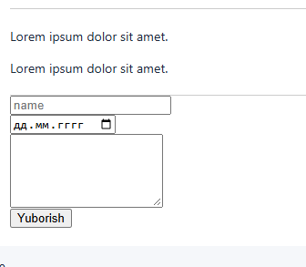
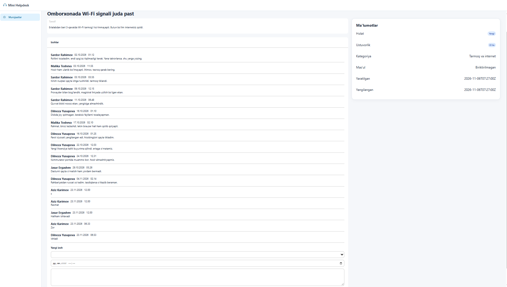

# TIL — bugun nima oʻrgandim

Har kuni ish oxirida 10-15 qator yozasiz: bugun nima oʻrgandingiz, oʻz soʻzlaringiz bilan.
Mentor ertangi daily'da shu fayldan savol beradi.

## Qoidalar

- Har bir kun uchun alohida sarlavha: `## YYYY-MM-DD`.
- Eng yangi kun eng tepada turadi (shu faylning "Yozuvlar" boʻlimi boshida).
- Har kuni **10-15 qator**, toʻrtta boʻlim bilan (namunaga qarang):
  - **Oʻrgandim** (4-6 qator): yangi tushuncha nima va nima uchun kerak.
  - **Loyihada** (2-4 qator): qayerda ishlatdingiz, fayl yoki PR raqami bilan.
  - **Muammo va yechim** (2-3 qator): nima ishlamadi, sababini qanday topdingiz.
  - **Savol** (1-2 qator): nimani hali tushunmadingiz.
- Hujjatdan nusxa olmang, oʻz soʻzlaringiz bilan yozing. Tushuntira olmagan narsangizni hali oʻrganmagansiz.
- Qatorni toʻldirish uchun yozmang: har bir qatorda bitta aniq fikr boʻlsin.
- Oʻzgarish joriy ticket PR'ingizga alohida commit sifatida qoʻshiladi: `docs: update TIL`.

## Namuna

```markdown
## 2026-11-18

### Oʻrgandim

- Signal qiymati oʻzgarganini eski va yangi qiymatni `===` bilan solishtirib biladi.
- Massivga `push` qilsam havola oʻsha-oʻsha qoladi, shuning uchun signal hech kimga xabar bermaydi.
- Toʻgʻri yoʻl: `update(list => [...list, item])`, yaʼni har safar yangi massiv.
- `set` qiymatni toʻliq almashtiradi, `update` esa oldingi qiymatdan yangisini hisoblaydi.
- json-server'da `/comments?ticketId=3` faqat shu murojaatning izohlarini qaytaradi.

### Loyihada

- B1: izohlar `ticket-detail.ts`da `comments` signal'ida saqlanadi.
- Yangi izoh POST'dan keyin server qaytargan obyekt `update` bilan roʻyxatga qoʻshiladi, qayta yuklanmaydi.

### Muammo va yechim

- Izoh qoʻshilgach ekranda chiqmadi. Network tab'da POST 201 qaytgan edi, demak muammo UI'da.
- Sababi `push` ekan, `update`ga almashtirdim.

### Savol

- `effect` qachon ishga tushadi va uni qayerda ishlatish mumkin emas?
```

## Yozuvlar

<!-- Yangi kunni shu qatordan keyin qoʻshing -->

------------------------------------------------------------------------------------------------------------------------------------------------------------------------

## 2026-11-19

### Oʻrgandim

- `Reactive Form` Angular/Forms дан импорт килинади. inject оркали FormBuilder чакирамиз. FormBuilder бизга форма яратишда йордам беради, у оркали FormGroup яратирилади. FormGroup   - ичида форманинг полялари жойлашган яний FormControl. 
- FormControl html даги  input га богланади formControlName оркали, энди у input ни TS оркали бошкарса болади
- `nonNullable`: TypeScript даражасида input string | null, nonNullable input қийматини null беришга йўл қўймайд ва reset() чақирилганда input бошланғич қийматига қайтаради.
- `markAllAsTouched` input ларни touched килиб кояди. Уни йордамида валидация хатоликларини user корсатаоламиз 
- `signal` Angularg га оз хакида ма'лумот беради
- `set` signal ни ма'лумотини озгартуриш учун ишлатиладиган метод
- `update` signal ни ески (signal озини) ма'лумотини асосида озгартуриш учун ишлатиладиган метод
- `computed` бошка signal асосида оз кийматини чикаради
- `effect` качен ишлатинилади, качонки signal озгаргандан сонг биз TS тарапта кандайдир иш килмокчи булсак


### Loyihada

- 
- 

### Muammo va yechim

- 
- 

### Savol

- 

------------------------------------------------------------------------------------------------------------------------------------------------------------------------

## 2026-11-20
### Oʻrgandim

- `signal` Angularg га оз хакида ма'лумот беради
- `set` signal ни ма'лумотини озгартуриш учун ишлатиладиган метод
- `update` signal ни ески (signal озини) ма'лумотини асосида озгартуриш учун ишлатиладиган метод
- `computed` бошка signal асосида оз кийматини чикаради
- `effect` качен ишлатинилади, качонки signal озгаргандан сонг биз TS тарапта кандайдир иш килмокчи булсак


### Loyihada

- Users get() запрос йордамида база дан олиб келдим ва уларни формани ичида селектга жойлаштирдим 

-------------------------------------------------------------------------------------------------------------------------------------------------------------------------

## 2026-11-23

### Oʻrgandim

- `getRawValue- формани ичидаги кийматларни олиб келади очирилга болса хам (disabled)`

### Loyihada

- Формани comments га POST метод оркали юбордим
- comments get() запрос йордамида база дан олиб келдим ва уларни формани тепа кисмига жойлаштирдим
- refactor: ger-all-users-funcrion  
Эски холат:
getAll(): Observable<HttpResponse<User[]>> {
    return this.http.get<User[]>(this.baseUrl,{
     observe: 'response'
    });
  }
Озгаргани:
getAll() {
    return this.http.get<User[]>(this.baseUrl);
  }
- 

----------------------------------------------------------------------------------------------------------------------------------------------------------------------------------

## 2026-11-24

### Oʻrgandim
- pipe ма'лумотни бизга керакли кориншда корсататиш учун хизмат килади

### Muammo va yechim
- Sana formatlash kodi takrorlanib ketgan: ticket-list.tsda formatCreatedAt va formatUpdatedAt funksiyalari bir xil.
Murojaat sahifasida esa sana umuman formatlanmagan, 2026-10-03T04:55:00Z ko'rinishida chiqyapti.
Mas'ul xodim ismi ham shablonda metod chaqirib olinyapti.
TS:
protected formatCreatedAt(ticket: Ticket): string {
    const date = new Date(ticket.createdAt);
    const day = String(date.getDate()).padStart(2, '0');
    const month = String(date.getMonth() + 1).padStart(2, '0');
    const year = date.getFullYear();
    const hours = String(date.getHours()).padStart(2, '0');
    const minutes = String(date.getMinutes()).padStart(2, '0');
    return `${day}.${month}.${year} ${hours}:${minutes}`;
  }
  protected formatUpdatedAt(ticket: Ticket): string {
    const date = new Date(ticket.updatedAt);
    const day = String(date.getDate()).padStart(2, '0');
    const month = String(date.getMonth() + 1).padStart(2, '0');
    const year = date.getFullYear();
    const hours = String(date.getHours()).padStart(2, '0');
    const minutes = String(date.getMinutes()).padStart(2, '0');
    return `${day}.${month}.${year} ${hours}:${minutes}`;
  }
  Html:
      <td 
          class="date-cell" 
          pTooltip="{{ticket.createdAt | date:'dd.MM.yyyy'}}" 
          tooltipPosition="top">{{
            ticket.createdAt | timeAgo}} 
      </td>
      <td 
          class="date-cell" 
          pTooltip="{{ticket.createdAt | date:'dd.MM.yyyy'}}" 
          tooltipPosition="top">
          {{ticket.updatedAt | timeAgo}}
       </td>


### Loyihada

- PIPE time-ago (shares/pipe/time-ago-pipe.ts) яратилди ва вазифада берилган жойларда ишлатилди 